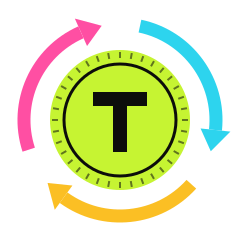
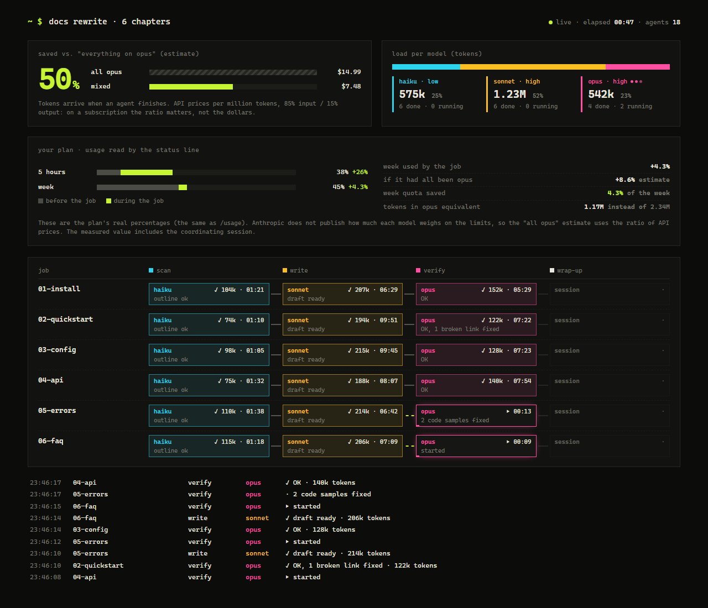
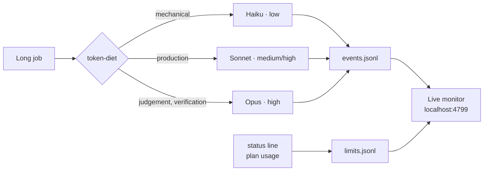

<div align="center">



# token-diet

**Put your Claude Code tokens on a diet: the right model and effort for each phase of a job, and a live monitor that shows what you save.**

A skill for [Claude Code](https://claude.com/claude-code) · Haiku reads, Sonnet writes, Opus verifies · no dependencies, just Node

[](LICENSE)


[Quick start](#quick-start) · [How it works](#how-it-works) · [The monitor](#the-monitor) · [Contributing](CONTRIBUTING.md)

<br>



</div>

## Why

Running everything on the strongest model is the easy default, and the expensive one. Most long jobs have phases that need very different brains: reading and sorting files, writing to a template that has already been approved, checking that what comes out is right. Only the last one really needs the top model.

On 26 November 2026 a real job (study maps on Italian law: 9 subjects, 27 sub-agents) ran with Haiku scanning the sources, Sonnet writing and Opus verifying every fact against the law text:

| Model | Tokens | Cost at API prices |
|---|---|---|
| Haiku | 1.04 M | ≈ $0.17 |
| Sonnet | 2.26 M | ≈ $7.24 |
| Opus | 2.08 M | ≈ $13.29 |
| **Total** | **5.38 M** | **≈ $20.70**, against ≈ $34.44 with everything on Opus: **−40%** |

Same output quality: the verification phase, where an error would have reached the reader, stayed on Opus. The whole story is in [`DEVLOG.md`](DEVLOG.md).

## What it does

- **Splits a job into phases** (mechanical, production, judgement and verification) and recommends a model and an effort level for each, with the exact command to apply it.
- **Asks five questions per phase** before stepping down: what an error would cost, whether there is a template to imitate, how much new reasoning is needed, how long and repetitive the work is, how much of the conversation's context it needs.
- **Tries a lower effort before a smaller model**, and warns when switching model mid-session would throw away the prompt cache.
- **Launches sub-agents on the right model** and shows them on a **live local monitor**: one row per job, one column per phase, tokens per model, estimated savings, and your real plan usage (5 hours and week) before and during the job.
- **Knows when to stay out of the way**: short tasks and models the user has already chosen are left alone.

## How it works



Each sub-agent writes a `start` event as its first action and `step` events while it works; the coordinating session writes `done` with the tokens from the completion notification. The monitor follows the files and streams them to the browser (Server-Sent Events). Nothing leaves your machine.

## Quick start

You need [Claude Code](https://claude.com/claude-code) and Node 18 or later. No `npm install`: the monitor uses only Node's standard library.

```bash
git clone https://github.com/fracabu/token-diet ~/.claude/skills/token-diet
```

That's it: Claude Code picks the skill up on its next start. To see the monitor right away with made-up data:

```bash
node ~/.claude/skills/token-diet/monitor/demo.mjs
```

Tested on Windows 11. The code is meant to work on macOS and Linux too, but it hasn't been tested there yet: if you try it, please open an issue.

### Optional: plan usage in the monitor

The "your plan" panel needs the status line to record your plan usage (Claude Code passes it to the status line as `rate_limits`, on Pro and Max plans). If you don't have a status line yet, use the one included:

```json
{ "statusLine": { "type": "command", "command": "node ~/.claude/skills/token-diet/monitor/statusline.mjs" } }
```

If you already have one, copy the `recordLimits()` function from [`monitor/statusline.mjs`](monitor/statusline.mjs) into it.

## Usage

**With Claude Code**, just ask: *"which model should I use for this?"*, *"can Haiku do this part?"*, *"let's save tokens"*, *"open the token monitor"*. The skill also steps in before a job that delegates to three or more sub-agents or repeats the same pattern many times. Instructions for Claude are in [`SKILL.md`](SKILL.md).

**From the command line**, in `monitor/`:

| Command | What it does |
|---|---|
| `node start.mjs --new --title "docs rewrite" --phases "scan:haiku,write:sonnet,verify:opus"` | start the monitor for a new job and open it |
| `node event.mjs 01-install write start "started" --model sonnet --effort high` | an agent starts |
| `node event.mjs 01-install write step "draft written"` | progress |
| `node event.mjs 01-install write done "draft ready" --model sonnet --tokens 207000 --sec 389` | done, with tokens |
| `node demo.mjs` | the monitor with made-up data, on port 4800 |

Statuses: `start`, `step`, `done`, `stop`, `error`. Phases become columns in the order they first appear.

## The monitor

`start.mjs` serves a single page on `localhost:4799` in a terminal-style dark theme. It shows:

- **saved versus "everything on Opus"**: tokens per model priced at API rates, 85% input and 15% output;
- **load per model**: tokens, agents done and running, effort;
- **your plan**: the real 5-hour and weekly percentages (the same as `/usage`), split into before and during the job;
- **the job grid**: one row per job, one cell per phase, with a timer while it runs and tokens and time when it's done;
- **the event log**: the last nine events.

On a subscription you don't pay per token, you use up the plan's limits. Anthropic does not publish how much each model weighs on those limits, so the "all Opus" plan estimate uses the ratio of API prices, and the measured figure includes the coordinating session. Treat it as an estimate, not a bill.

## Privacy and limits

- Everything runs locally: the monitor listens on `localhost` and reads files on your machine.
- Data (events, archived runs, plan usage, server log) lives in `~/.token-diet/` (or `$TOKEN_DIET_HOME`), never in the skill folder or the repo.
- A skill cannot change the model of your main session: it recommends, you switch (`/model`, `/effort`). Sub-agents are launched directly on the right model.
- Model names and prices change. The table in `SKILL.md` carries the date it was checked; recheck it if it is more than a few months old.

## Contributing

Tests on macOS and Linux, better heuristics for choosing a model, real numbers from your own jobs, fixes and ideas are all welcome. Start with [`CONTRIBUTING.md`](CONTRIBUTING.md).

## License

[MIT](LICENSE) · made by [@fracabu](https://github.com/fracabu)
